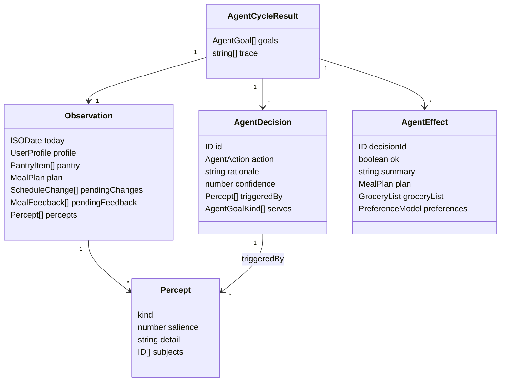
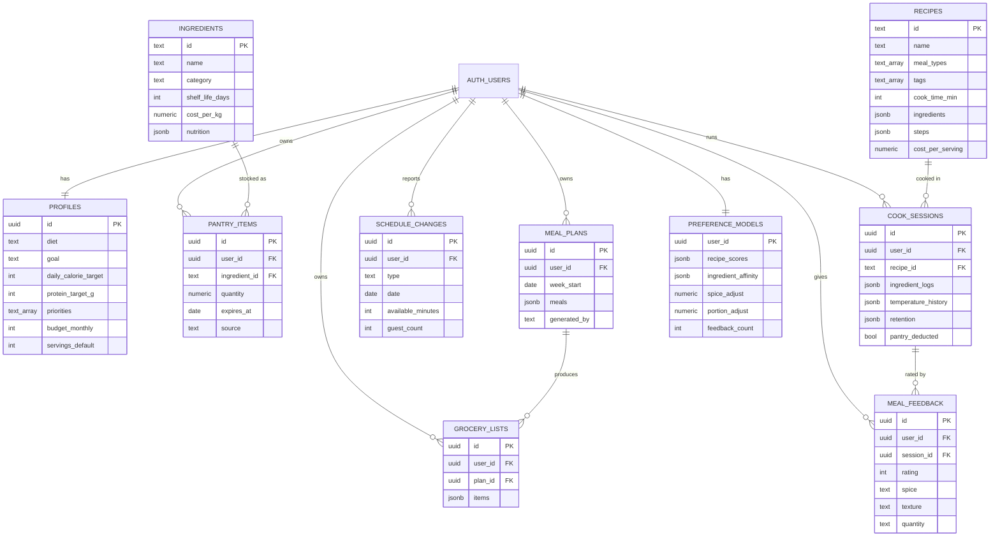

# Cookwise — Agent Architecture & Schema

Cookwise is an **autonomous agentic system** for meal planning and cooking. It
is not a chatbot and not a single-prompt wrapper. It senses the state of a
user's kitchen, decides what to do about it, acts on that decision, observes
the result, learns from it, and re-plans.

This document is the schema of the development: the agent loop, the decision
model, the data model, and the map from each to the code that implements it.

---

## 1. Why this is an agent

A system earns the name *agent* when it does more than answer. These are the
properties and where each one lives.

| Property | How Cookwise satisfies it |
|---|---|
| **Goals** | Derived from the user's ranked priorities, not hard-coded. `goalsFor()` |
| **Perception** | Camera, receipt scan, weight and temperature sensors, pantry and plan state |
| **Autonomy** | Chooses its own actions from sensed state; no fixed script |
| **Deliberation** | Ranks percepts by salience, orders actions by dependency |
| **Action** | Writes plans, shopping lists and preference models |
| **Feedback** | Nutrient retention from real cook logs; post-meal ratings |
| **Learning** | Exponential moving average over ratings updates a preference model |
| **Accountability** | Every action carries a rationale and the percepts that caused it |
| **Degradation** | Every AI route falls back to a deterministic local engine |

The last two matter most. An agent that cannot explain a choice cannot be
audited, and an agent that dies without a network key is not autonomous.

---

## 2. The agent loop

```mermaid
flowchart LR
    subgraph SENSE["1 · PERCEIVE"]
        A1[Pantry & expiry]
        A2[Camera / receipt]
        A3[Scale & thermometer]
        A4[Schedule changes]
        A5[Meal ratings]
    end

    subgraph THINK["2 · DECIDE"]
        B1[Rank percepts<br/>by salience]
        B2[Weight goals from<br/>user priorities]
        B3[Select & order<br/>actions]
    end

    subgraph ACT["3 · ACT"]
        C1[Generate plan]
        C2[Adapt plan]
        C3[Build grocery list]
        C4[Flag expiring stock]
    end

    subgraph LEARN["4 · OBSERVE & LEARN"]
        D1[Nutrient retention<br/>from cook logs]
        D2[Rating & taste<br/>feedback]
        D3[Update preference<br/>model]
    end

    SENSE --> THINK --> ACT --> LEARN
    LEARN -- "next cycle" --> SENSE
```



One call to `runCycle()` is one complete turn of this loop.

### Execution order is deliberate

Decisions are not independent. The policy emits them in dependency order and
the orchestrator threads state through them:

1. **Learn first.** New ratings fold into the preference model *before*
   planning, so the plan built later in the same cycle already reflects them.
2. **Plan or adapt, never both.** If a plan exists and the user reported a
   change, the agent adapts it rather than regenerating, which preserves
   locked and already-cooked meals.
3. **Shop last.** The grocery list derives from the *final* plan minus the
   pantry, so it cannot drift from what was actually scheduled.

---

## 3. Decision model

The agent's own vocabulary, defined in [`src/lib/agent/types.ts`](../src/lib/agent/types.ts).



### Percepts

Signals the agent can sense, each scored `0..1` for salience.

| Percept | Raised when | Salience |
|---|---|---|
| `no_plan` | No plan for the current week | Always 1.0 |
| `stale_plan` | Plan older than the stale threshold | 0.9 |
| `expiring_stock` | Pantry items inside the waste window | Rises as the deadline nears |
| `schedule_change` | User reported a change | 1.0 today, 0.7 future |
| `unprocessed_feedback` | Ratings not yet learned from | Rises with count |
| `missing_grocery_list` | Plan exists with no list | 0.6 |
| `budget_risk` | Estimated spend over weekly budget | Scales with the overrun |

### Actions

| Action | Effect | Engine called |
|---|---|---|
| `generate_plan` | Builds a 7-day plan | `generateWeekPlan` |
| `adapt_plan` | Re-plans around a change | `adaptPlan` |
| `build_grocery_list` | Plan minus pantry | `buildGroceryList` |
| `learn_preferences` | Folds ratings into the model | `applyFeedback` |
| `flag_expiring` | Surfaces spoiling stock | `expiringStock` |
| `no_op` | Deliberate inaction, with a reason | none |

`no_op` is a real action, not a failure. When the grocery list exceeds the
budget, the agent **reports** it rather than silently cutting meals, because
trading cost against nutrition is the user's call, not the agent's.

### Goals

The user's ranked priorities become weighted goals. First priority gets the
largest weight; every goal keeps a small floor so none is ever ignored.

| User priority | Agent goal |
|---|---|
| `nutrition` | `nutrition` |
| `time` | `time` |
| `budget` | `budget` |
| `taste` | `taste` |
| `waste_reduction` | `waste` |
| *(not user-ranked)* | `health` — nutrient retention |

### Safety rails

| Rail | Purpose |
|---|---|
| `minConfidence` | Decisions below the floor are reported but not executed |
| `maxActionsPerCycle` | One cycle cannot thrash the user's state |
| Pure functions | No I/O in the agent, so every decision is reproducible |
| Seeded RNG | Same input and seed always yields the same plan |

---

## 4. Database schema

Ten tables, defined in
[`supabase/migrations/0001_init.sql`](../supabase/migrations/0001_init.sql)
and mirrored by the TypeScript domain model in
[`src/lib/types.ts`](../src/lib/types.ts). Every user-owned table is protected
by row-level security.



### How the schema closes the loop

`COOK_SESSIONS` is where sensing becomes data: ingredient logs come from the
scale, temperature history from the thermometer, and `retention` is computed
from both. `MEAL_FEEDBACK` captures the human verdict. `PREFERENCE_MODELS`
accumulates both into a model that changes the next `MEAL_PLANS` row the agent
writes. That cycle is the product.

---

## 5. Code map

| Layer | Path | Responsibility |
|---|---|---|
| Agent types | `src/lib/agent/types.ts` | Goal, Percept, Decision, Action, Effect |
| Perception & policy | `src/lib/agent/policy.ts` | `perceive`, `decide`, `goalsFor` |
| Orchestrator | `src/lib/agent/agent.ts` | `CookwiseAgent.runCycle` |
| Tests | `src/lib/agent/__tests__/` | 20 tests over the loop |
| Planning engine | `src/lib/engines/planner.ts` | `generateWeekPlan`, `adaptPlan` |
| Learning engine | `src/lib/engines/learning.ts` | `applyFeedback`, `recommend` |
| Retention engine | `src/lib/engines/retention.ts` | USDA factors + thermal kinetics |
| Grocery engine | `src/lib/engines/grocery.ts` | `buildGroceryList` |
| AI routes | `src/app/api/ai/*` | Gemini, each with a local fallback |
| Domain model | `src/lib/types.ts` | Shared contracts |
| Persistence | `supabase/migrations/0001_init.sql` | Tables, indexes, RLS |

---

## 6. Using the agent

```ts
import { runAgentCycle } from "@/lib/agent";

const result = runAgentCycle({
  today: "2026-10-11",
  weekStart: "2026-10-12",
  profile,
  recipes,
  ingredients,
  pantry,
  preferences,
  pendingFeedback,
});

// What it decided, and why.
for (const d of result.decisions) {
  console.log(d.action.type, "—", d.rationale, `(${d.confidence})`);
}

// New state to persist.
const plan = result.effects.find((e) => e.plan)?.plan;
```

Every cycle returns a `trace`, a flat ordered log of perception, deliberation
and action, suitable for showing the user exactly why their week changed.

---

## 7. Verification

```bash
npm test
```

```bash
npx tsc --noEmit
```

The agent suite covers goal weighting, each percept, decision ordering,
determinism under a fixed seed, the confidence floor, the action cap, adapting
over regenerating, and budget flagging.
